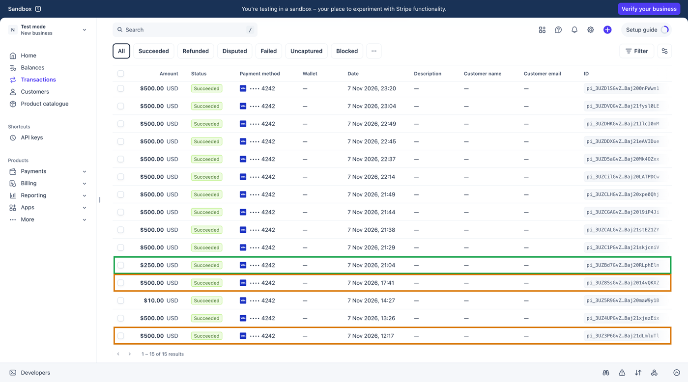
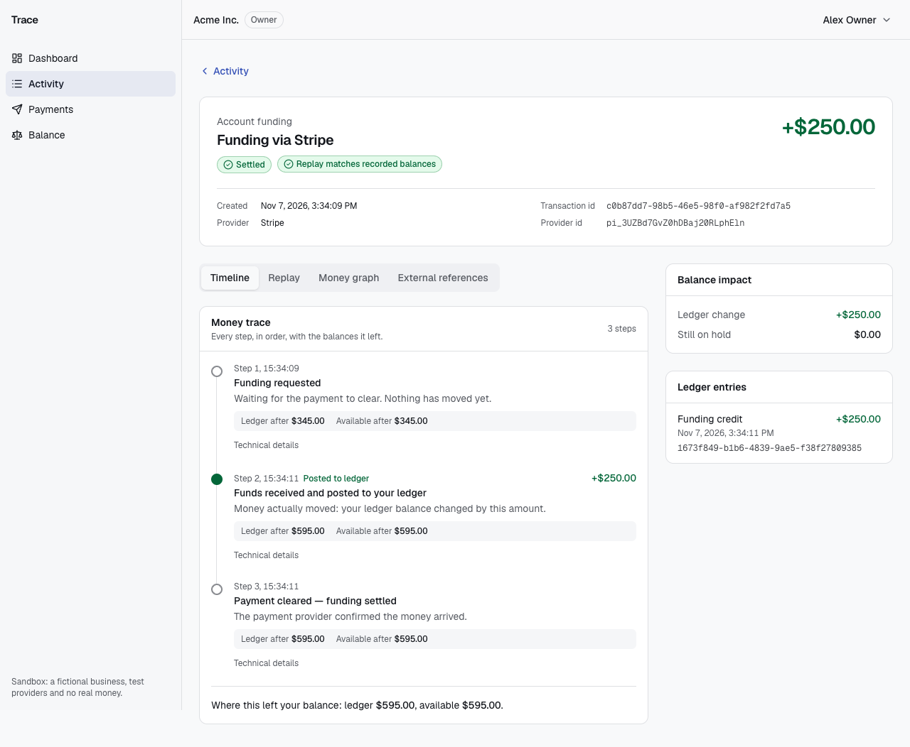
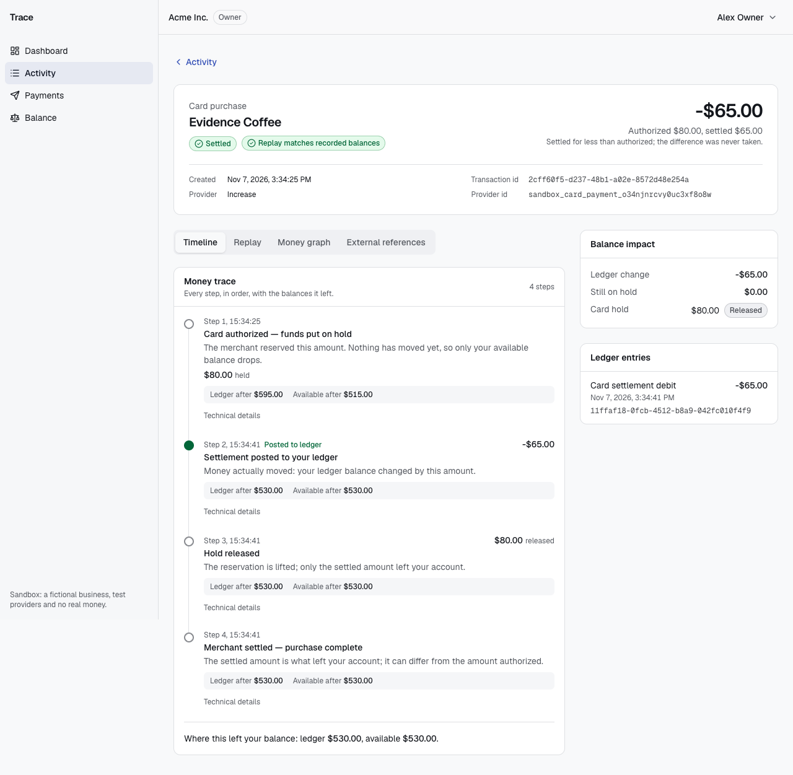
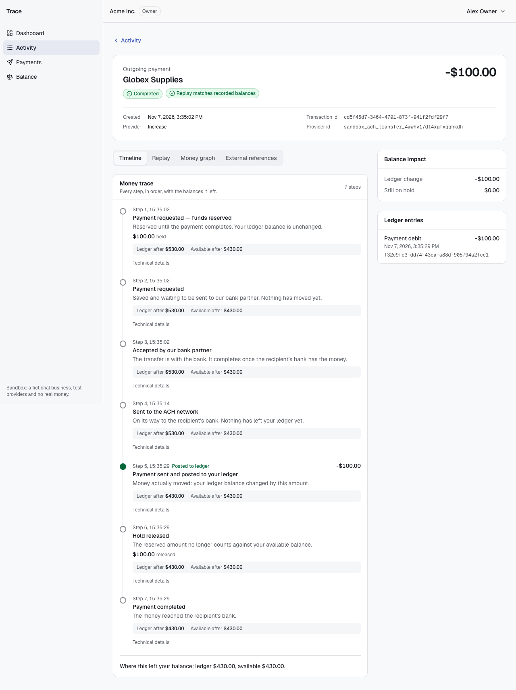
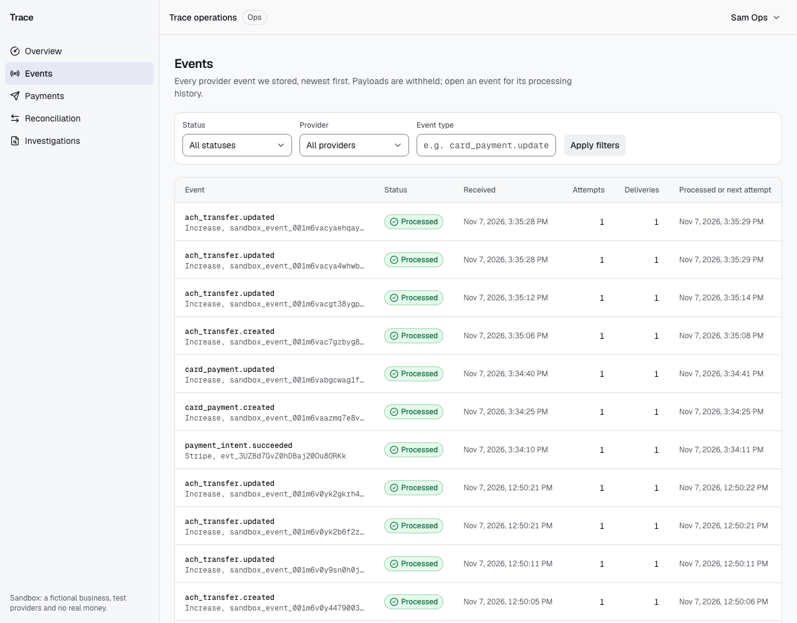
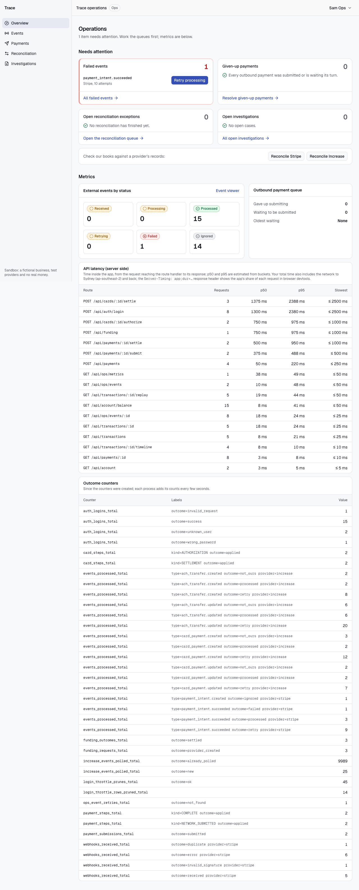
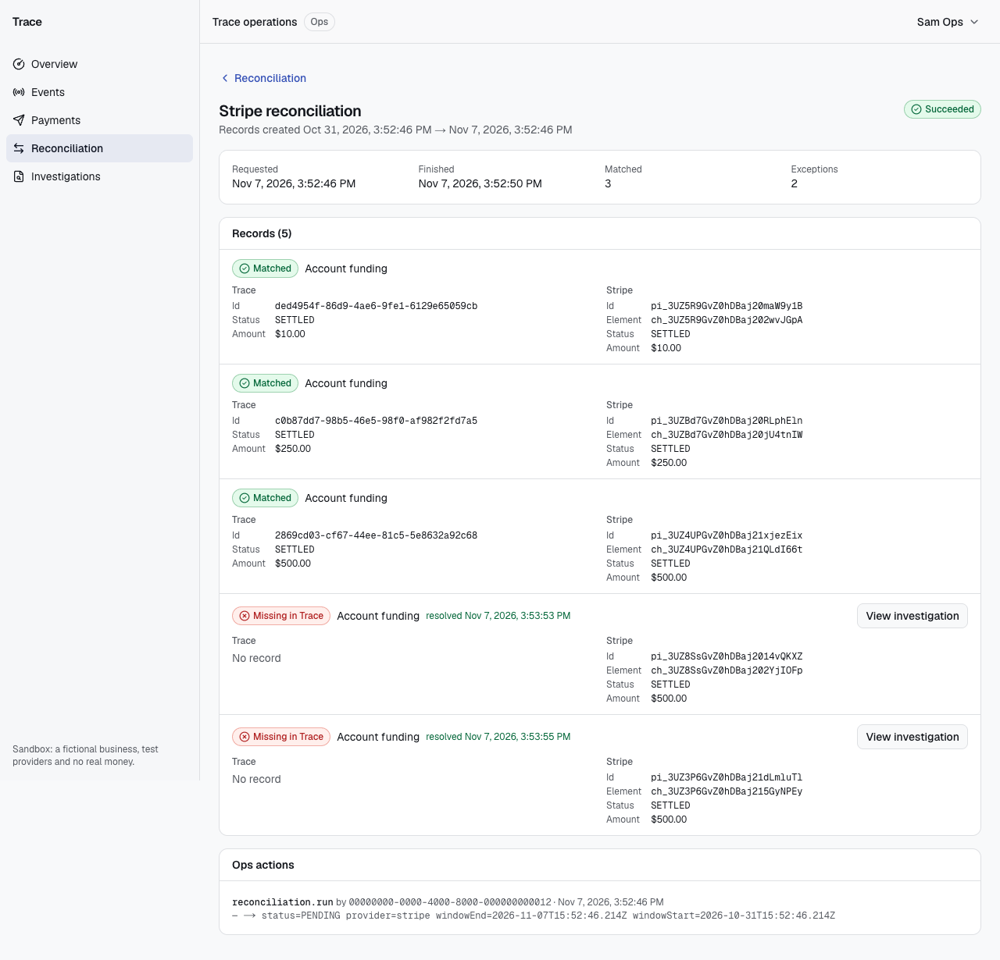
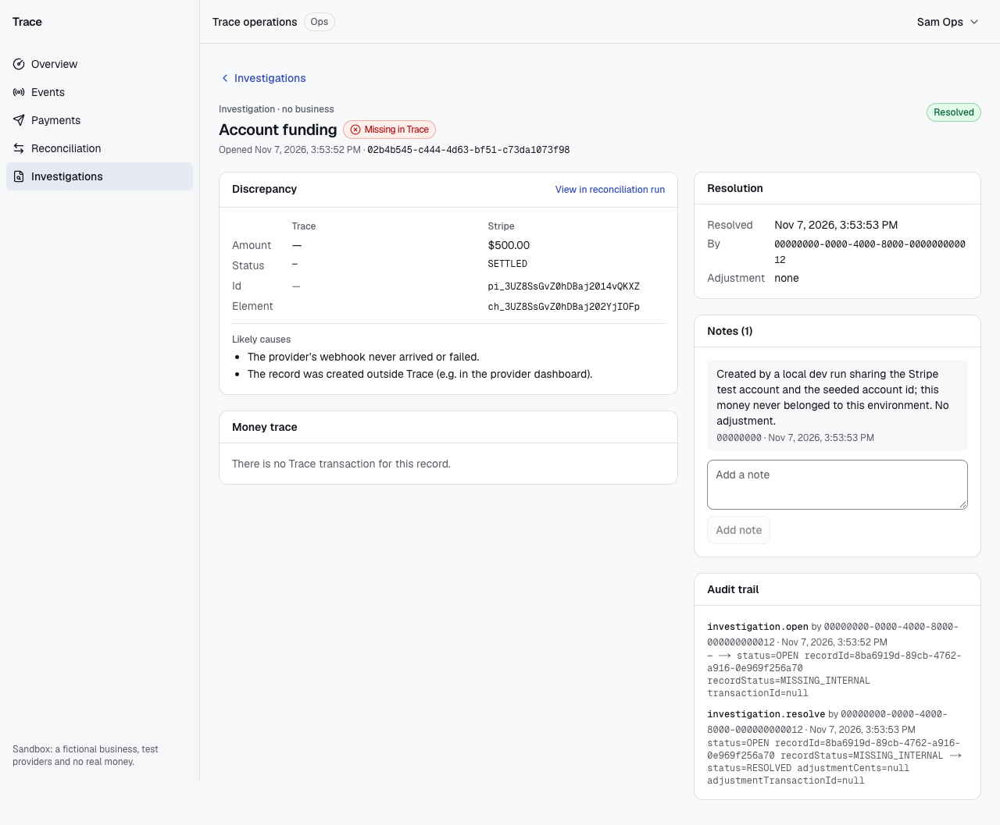

# Sandbox integration evidence

On 7 Nov 2026 between 15:34 and 15:36 UTC we ran three fresh flows against the deployed app,
<https://d3aloylres4vpz.cloudfront.net>. Each flow was signed in through the real login
(`POST /api/auth/login`) as the seeded owner, `owner@acme.test`, and as Ops, `ops@trace.test`.
Every id below came from the app's API and was then read back from the provider's own API.

| Flow | Provider | Our transaction | Result | Replay |
|---|---|---|---|---|
| (a) Funding $250.00 | Stripe test mode, webhook | `c0b87dd7-98b5-46e5-98f0-af982f2fd7a5` | SETTLED in 2.4 s | consistent: true |
| (b) Card: authorize $80.00, settle $65.00 | Increase sandbox, Events API poller | `2cff60f5-d237-48b1-a02e-8572d48e254a` | AUTHORIZED, then SETTLED | consistent: true |
| (c) ACH payment $100.00 | Increase sandbox, Events API poller | `cd5f45d7-3464-4701-873f-941f2fdf29f7` (payment `b9c0b8c6-8ea1-4f5b-b051-c79af7c6eebf`) | PENDING, SUBMITTED, COMPLETED | consistent: true |

Account `00000000-0000-4000-8000-000000000021`, Acme Inc. Times are in UTC. Stripe and Increase
timestamps are whole seconds. Ours come from `transaction_events` and `external_events`.

## (a) Stripe funding: `POST /api/funding`

| Step | Our status | Provider id | Provider status (read from Stripe API) | Time (UTC) |
|---|---|---|---|---|
| Request accepted, PaymentIntent created and confirmed (`pm_card_visa`) | PENDING | `pi_3UZBd7GvZ0hDBaj20RLphEln` | `succeeded`, amount 25000 usd, `livemode: false`, metadata `transaction_id` = ours | 15:34:09.099 (Stripe: 15:34:09) |
| Charge | | `ch_3UZBd7GvZ0hDBaj20jU4tnIW` | `succeeded`, `paid: true`, 25000 | 15:34:09 |
| Webhook received at `/api/webhooks/stripe` | event RECEIVED | `evt_3UZBd7GvZ0hDBaj20Ou8ORKk` `payment_intent.succeeded` | `pending_webhooks: 0` (every endpoint acknowledged it) | 15:34:10.333 |
| Worker: LEDGER_POSTED +$250.00, then STATUS_CHANGED | SETTLED | `provider_ref` = the charge id | | 15:34:11.459 |

The balance went from ledger $345.00 / available $345.00 to ledger $595.00 / available $595.00,
which is +$250.00 on both.

### On Stripe's side: the Stripe dashboard

Stripe's own dashboard (test mode, Transactions; times in IST, UTC+5:30) lists every PaymentIntent
in the test account:
- **Green:** the $250.00 from flow (a), `pi_3UZBd7…RLphEln`, Succeeded at 21:04 IST (15:34 UTC).
- **Amber:** the two $500.00 PaymentIntents from local dev runs that reconciliation flagged as
  MISSING_INTERNAL (see [Reconciliation](#reconciliation)): `pi_3UZ8Ss…4vQKXZ` and `pi_3UZ3P6…dLmluTl`.
- The other $500.00 and $10.00 rows are earlier and later fundings from the deployed app and the
  walkthrough recordings.



## (b) Increase card: `POST /api/cards/:id/authorize`, then `…/settle`

Card `00000000-0000-4000-8000-000000000031`. At Increase it is `sandbox_card_f8gp0xczuusxnnhrpd9y`.

| Step | Our status | Provider id | Provider status (read from Increase API) | Time (UTC) |
|---|---|---|---|---|
| Authorize $80.00 requested (202) | | `sandbox_card_payment_o34njnrcvy0uc3xf8o8w` | card_payment created 15:34:21 | 15:34:21 |
| Authorization element | | `sandbox_card_authorization_ao0esxgd9o93wdhdp1n4` | amount 8000, 15:34:21 | |
| Event polled and processed: HOLD_CREATED $80.00 | AUTHORIZED | `sandbox_event_001m6vaazmq7e8v4schpw2jkk8m` `card_payment.created` | event created 15:34:22 | received 15:34:25.261, applied 15:34:25.856 |
| Settle $65.00 requested (202) | | settlement element `sandbox_card_settlement_swwnv44qpk08v0r3q5iq` | amount 6500, 15:34:38; card_payment state `authorized_amount 8000`, `settled_amount 6500` | 15:34:38 |
| Event polled and processed: LEDGER_POSTED −$65.00, HOLD_RELEASED $80.00, STATUS_CHANGED | SETTLED | `sandbox_event_001m6vabgcwag1fgtj4r0pf1hth` `card_payment.updated` | event created 15:34:39 | received 15:34:40.921, applied 15:34:41.186 |

| Point | Ledger | Card holds | Available |
|---|---|---|---|
| Before | $595.00 | $0.00 | $595.00 |
| After authorization | $595.00 | $80.00 | $515.00 |
| After settlement | $530.00 | $0.00 | $530.00 |

The ledger moved only by the settled $65.00. The $15.00 difference between the authorization and
the settlement was never taken.

## (c) Increase ACH: `POST /api/payments`, then `…/submit` and `…/settle`

| Step | Our status | Provider id | Provider status (read from Increase API) | Time (UTC) |
|---|---|---|---|---|
| Payment created: HOLD_CREATED $100.00 | PENDING | | | 15:35:02.235 |
| Worker submits with `Idempotency-Key: payment-b9c0b8c6-…` | SUBMITTED | `sandbox_ach_transfer_4wwhv17dt4xgfxqqhkdh` | created 15:35:02, `idempotency_key` = `payment-b9c0b8c6-8ea1-4f5b-b051-c79af7c6eebf` | 15:35:02.641 |
| `ach_transfer.created` polled | (no change) | `sandbox_event_001m6vac7gzbyg86cnmz2vgyy10` | event created 15:35:02 | received 15:35:06.994 |
| `POST /api/payments/:id/submit` simulates the FedACH submission: SUBMITTED_TO_NETWORK | SUBMITTED | `sandbox_event_001m6vacgt38ygpjwvqgkd76nb0` `ach_transfer.updated` | `submission.submitted_at` 15:35:11 | received 15:35:12.712, applied 15:35:14.106 |
| `POST /api/payments/:id/settle` simulates settlement: LEDGER_POSTED −$100.00, HOLD_RELEASED, STATUS_CHANGED | COMPLETED | `sandbox_event_001m6vacya4whwbw4hjj0m426kv` `ach_transfer.updated` | `settlement.settled_at` 15:35:25 | received 15:35:28.756, applied 15:35:29.384 |
| Second update for the same state | (no change) | `sandbox_event_001m6vacyaehqay06vskpmyv8wj` `ach_transfer.updated` | event created 15:35:26 | processed with no new step |

Increase's top-level `status` stays `submitted` after settlement. Settlement is recorded in the
transfer's `settlement` object, and our COMPLETED status follows from that object.

| Point | Ledger | Pending payments | Available |
|---|---|---|---|
| Before | $530.00 | $0.00 | $530.00 |
| After create (hold) | $530.00 | $100.00 | $430.00 |
| After settlement | $430.00 | $0.00 | $430.00 |

## Replay

`GET /api/transactions/:id/replay` returned `"consistent": true` for all three transactions.
Replay rebuilds the transaction from its trace rows and checks every step's ledger and available
balances, and each posting against its ledger entry. The transaction pages show the same result as
the badge "Replay matches recorded balances".

| Funding | Card | ACH |
|---|---|---|
|  |  |  |

## Ops view

Ops event viewer (`/ops/events`): each of the seven events of these flows (the top seven rows) was
PROCESSED in one attempt with one delivery. Payloads are withheld.



- **Delivery source.** `event_deliveries.source` records whether a delivery came from a webhook
  or a poll, but the Ops API and UI don't show it yet. The evidence for each path is indirect:
  - Stripe's event reached us 1 s after it was created, and Stripe reports `pending_webhooks: 0`.
  - The Increase account has no event subscriptions (`GET /event_subscriptions` returns 0), and
    its events arrived 3 to 4 s after creation, in line with the 5 s poll.
All counter values below were read from the Ops dashboard at **15:54:33 UTC**, in the same page
load as the screenshot. They count everything since the deploy, including earlier runs today.

- **Idempotent dedupe:**
  - `increase_events_polled_total{outcome="already_polled"}` = 10,684. These are overlap
    re-reads, and none was recorded or applied again. `{outcome="new"}` = 25.
  - `webhooks_received_total{provider="stripe",outcome="duplicate"}` = 1. That duplicate is
    event `evt_trace_selftest_c6f0e8b7b9ed`: 2 deliveries, stored once, IGNORED.
- **Counters for these flows:**
  - `funding_outcomes_total{settled}` 3
  - `card_steps_total{AUTHORIZATION,applied}` 2 and `{SETTLEMENT,applied}` 2
  - `payment_submissions_total{submitted}` 2
  - `payment_steps_total{NETWORK_SUBMITTED,applied}` 2 and `{COMPLETE,applied}` 2
  - Events by status: PROCESSED 15, FAILED 1, IGNORED 14. Payment backlog: 0 pending, 0 given up.
- **Other counters on the dashboard and their causes** (from the worker and web logs):
  - `webhooks_received_total{stripe,error}` = 6. These were deliberate bad-signature smoke tests
    at 07:34 and 07:40 UTC. Before commit `1f9f871`, the production build didn't recognise a
    signature error (an `instanceof` check across bundles), so it answered 500 instead of 400.
  - `webhooks_received_total{stripe,invalid_signature}` = 1. The same smoke test, re-run at 07:56
    UTC after that fix, correctly got a 400.
  - `events_processed_total{increase,…,retry}` = 47, across the four Increase event types. All
    happened between 12:41:25 and 12:42:02 UTC, during the rolling deploy of the poller:
    - The new worker task's poller ingested events while the old task was still claiming them.
    - The old task's code predates `9ebeb4b` and rejected the anonymous sandbox's `sandbox_` id
      prefix (`ZodError`), so those events were retried.
    - The new task then processed them, or marked them not ours.
  - `events_processed_total{stripe,payment_intent.succeeded,retry}` = 9 and `{failed}` = 1 are
    the ten attempts of the FAILED event below.



The one FAILED event, `evt_3UZ8SsGvZ0hDBaj204FVJuYb` from 12:11 UTC, is not part of these flows.
Its PaymentIntent was created by a local dev run against a local database that shares this Stripe
test account. Stripe also delivered the event here, and this database has no such transaction
(`FundingNotFoundError`), so the event ended FAILED and surfaces to Ops. See
[Reconciliation](#reconciliation).

## Reconciliation

At 15:52 UTC, as Ops, we ran Reconcile Stripe and Reconcile Increase (default window: the last 7
days). Both runs SUCCEEDED in one attempt. Each compares our books with records fetched from the
provider's API.

| Provider | Run | Matched | Exceptions |
|---|---|---|---|
| Increase | `79b93333-e16b-4237-882a-b236cbc4c2eb` | 4 | 0 |
| Stripe | `3f7efc3e-c514-405b-a268-5646c3d0a1c7` | 3 (including flow a) | 2 MISSING_INTERNAL |

The two MISSING_INTERNAL records are $500.00 PaymentIntents that Stripe has and this environment
doesn't:
- `pi_3UZ3P6GvZ0hDBaj21dLmluTl`, created 06:47 UTC.
- `pi_3UZ8SsGvZ0hDBaj2014vQKXZ`, created 12:11 UTC.

Both were created by local dev runs:
- The local runs used the same Stripe test account, and their PaymentIntents carry our
  `transaction_id` metadata, so this deployment treats them as ours.
- Their transactions exist only in the local databases.

Reconciliation caught this correctly: Stripe holds money our books never had.

Ops opened an investigation for each record and resolved it with a note and no adjustment, since
the money never belonged to this environment:
- `02b4b545-c444-4d63-bf51-c73da1073f98`
- `cc767778-86bb-4c95-bc82-8e88c3454d1a`

Each record now shows as resolved. The comparison itself was not edited, and the audit trail
records both the open and the resolve actions.

| Stripe run | Resolved investigation |
|---|---|
|  |  |

## What is mocked or limited

- **Sandboxes only.** Stripe runs in test mode (`livemode: false`, `pm_card_visa`) and Increase in
  its sandbox. No real money moves.
- **Card and ACH steps are simulated.** The routes `/api/cards/:id/{authorize,settle}` and
  `/api/payments/:id/{submit,settle}` call Increase's sandbox simulation endpoints. They write
  nothing themselves: our books change only when the resulting Increase event arrives and the
  worker applies it.
- **No Increase dashboard screenshots.** We use Increase's anonymous API sandbox, created through
  its API without an account, so there is no dashboard to capture. Increase's side is shown by its
  own API responses: every Increase id in this page was read back with a GET to the sandbox API.
- **Increase events come from polling, not webhooks.** The anonymous Increase sandbox has no
  webhook subscriptions, so the worker polls `GET /events` every 5 s. The polled events go
  through the same ingestion path as a webhook body would. The Increase webhook route exists and
  is tested, but it receives nothing in this deployment.
- **Stripe webhooks hit the deployed app.** A Stripe test-mode endpoint
  `we_1UZ3v0GvZ0hDBaj2SRv7Lf4a` points at
  `https://d3aloylres4vpz.cloudfront.net/api/webhooks/stripe` for `payment_intent.succeeded` and
  `payment_intent.payment_failed`. No `stripe listen` is involved.
- **The app is hosted in Sydney** (AWS ap-southeast-2, behind CloudFront). From the UK, each
  request adds about 270 ms of round trip. The slower simulation routes, around 0.4 to 2.4 s
  server side, are mostly waiting on Increase.
- **One Stripe test account is shared with local dev.** The Stripe webhook endpoint receives
  every event in the shared test account, so local runs' PaymentIntents reach this deployment and
  its reconciliation (see above).
- **Screenshots** were taken in UTC, logged in from saved session cookies, with no password on
  screen.

## What's next

- Separate local dev from the deployed app: a Stripe test account per environment, or an
  environment tag in the PaymentIntent metadata that the webhook handler and the reconciler
  check, so another environment's payments end up IGNORED as not ours.
- Show `event_deliveries.source` (webhook or poll) in the Ops event detail.

## How to reproduce

```sh
B=https://d3aloylres4vpz.cloudfront.net
curl -s -c jar -H 'content-type: application/json' -d '{"email":"owner@acme.test","password":"<owner password>"}' $B/api/auth/login
curl -s -b jar -H 'content-type: application/json' -H "Idempotency-Key: $(uuidgen)" -d '{"amountCents":25000}' $B/api/funding
curl -s -b jar -H 'content-type: application/json' -d '{"amountCents":8000}' $B/api/cards/00000000-0000-4000-8000-000000000031/authorize
# transaction id: GET $B/api/transactions (items[].providerObjectId = the cardPaymentId), a few seconds later
curl -s -b jar -H 'content-type: application/json' -d '{"transactionId":"<id>","amountCents":6500}' $B/api/cards/00000000-0000-4000-8000-000000000031/settle
curl -s -b jar -H 'content-type: application/json' -H "Idempotency-Key: $(uuidgen)" \
  -d '{"recipientName":"Globex Supplies","accountNumber":"987654321","routingNumber":"101050001","amountCents":10000}' $B/api/payments
# submit simulates the FedACH submission; call it once our worker has sent the transfer (status SUBMITTED)
curl -s -b jar -X POST $B/api/payments/<payment id>/submit
curl -s -b jar -X POST $B/api/payments/<payment id>/settle
curl -s -b jar $B/api/transactions/<id>/replay               # "consistent": true
```

Then open `/transactions/<id>` as the owner. As Ops, open `/ops` and `/ops/events`, and use
Reconcile Stripe / Reconcile Increase on `/ops`.
